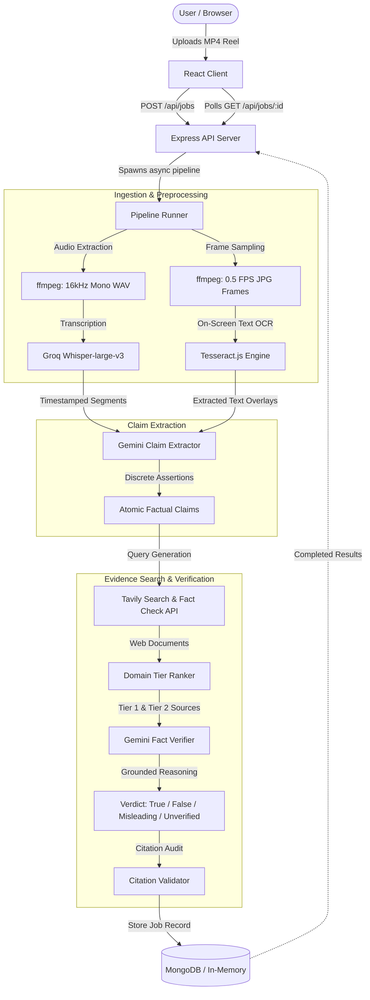

# CapCatcher

> **Catch the cap in any reel.** Automated multimodal fact-checking for short-form video.

Short-form videos (Instagram Reels, YouTube Shorts, TikTok) spread viral misinformation faster than text-based claims because evidence is split across spoken audio, on-screen text overlays, and fast visual cuts. **CapCatcher** solves this by decomposing vertical reels into synchronized speech and visual frames, extracting discrete checkable assertions, cross-referencing authoritative sources across credibility tiers, and validating citations with exact timestamps.

---

## Tech Stack

- **Frontend**: React 18, Vite, Vanilla CSS
- **Backend**: Node.js (ESM), Express.js, Multer
- **Audio & Video Processing**: `fluent-ffmpeg`, `ffmpeg-static`
- **Speech-to-Text**: Groq API (`whisper-large-v3`)
- **Optical Character Recognition (OCR)**: Tesseract.js (English model)
- **Claim Extraction & Fact Verification**: Google Gemini API (`gemini-1.5-flash` / `gemini-3.1-flash-lite`)
- **Evidence Retrieval**: Tavily Search API, Google Fact Check Tools API
- **Database**: MongoDB via Mongoose (with automated fallback to `mongodb-memory-server` in dev mode)

---

## Architecture Overview



---

## Features

- **Multimodal Video Ingestion**: Processes vertical 9:16 videos, sampling audio at 16 kHz and video at 0.5 fps (1 frame every 2 seconds, capped at 30 frames).
- **Dual-Stream Claim Extraction**: Simultaneously transcribes spoken narration with Groq Whisper and extracts on-screen text overlays with Tesseract OCR, merging them into unified, timestamp-anchored assertions.
- **Credibility Tier Ranking**: Prioritizes evidence using a tiered domain hierarchy:
  - **Tier 1 (High)**: Government portals (`.gov`), academic institutions (`.edu`), international agencies (WHO, NASA, NOAA), and recognized fact-checkers (Snopes, PolitiFact, FactCheck.org).
  - **Tier 2 (Medium)**: Established scientific encyclopedias, peer-reviewed journals, and mainstream news outlets (Reuters, AP).
  - **Tier 3 (Standard)**: General web publications.
- **Citation Guardrails**: Enforces that models cite only retrieved source IDs (`S1`, `S2`). If an explanation references fabricated sources or fails source cross-validation, the verdict automatically falls back to `unverified`.
- **Zero-Config Local Development**: Automatically spins up an in-memory MongoDB server (`mongodb-memory-server`) if no external connection string is provided.
- **Interactive UI & Demo Reel**: Includes a built-in sample reel runner to test the full fact-checking interface without uploading local video files.

---

## Project Structure

```
CapCatcher/
├── client/                     # Vite + React frontend application
│   ├── src/                    # UI components, polling logic, and styles
│   ├── package.json            # Client dependencies (React 18, Vite)
│   ├── vite.config.js          # Dev server and /api proxy configuration
│   └── .env.example            # Frontend environment template
├── server/                     # Express.js backend application
│   ├── data/domainTiers.json   # Domain credibility tiers (Tier 1-3)
│   ├── models/Job.js           # Mongoose Job schema and status tracking
│   ├── routes/jobs.js          # REST endpoints (POST /api/jobs, GET /api/jobs/:id)
│   ├── services/               # Modular pipeline components
│   │   ├── media.js            # ffmpeg audio extraction & frame sampling
│   │   ├── transcribe.js       # Groq Whisper integration
│   │   ├── ocr.js              # Tesseract worker & confidence filtering
│   │   ├── claims.js           # Gemini prompt-based claim extraction
│   │   ├── search.js           # Tavily & Google Fact Check search client
│   │   ├── rank.js             # Domain tier scoring & source sorting
│   │   └── verify.js           # Gemini evidence grounding & citation check
│   ├── package.json            # Server dependencies
│   └── .env.example            # Backend environment template
├── eval/                       # Benchmark evaluation suite
│   ├── capcatcher/             # 12 synthetic test reels and ground-truth labels
│   ├── results/                # Raw empirical metric dumps (JSON)
│   ├── evaluate_all.js         # Benchmark test runner (Steps 2–6)
│   ├── check_citations.js      # Citation HTTP & topical audit script
│   └── RESULTS.md              # Detailed empirical report & resume-safe claims
├── .env.example                # Root environment template
├── .gitignore                  # Master gitignore for Node/MERN stack
└── README.md                   # Project documentation
```

---

## Prerequisites & Installation

### Prerequisites

- [Node.js](https://nodejs.org/) (v18.0.0 or higher)
- [npm](https://www.npmjs.com/) (v9.0.0 or higher)
- System `ffmpeg` is optional (`ffmpeg-static` is installed as a server dependency)
- API Keys:
  - **Groq API Key**: Free tier available at [console.groq.com](https://console.groq.com)
  - **Google Gemini API Key**: Free tier available at [aistudio.google.com](https://aistudio.google.com)
  - **Tavily Search API Key**: Free tier available at [app.tavily.com](https://app.tavily.com)
  - **Google Fact Check API Key**: Optional, available via [Google Cloud Console](https://console.cloud.google.com)

---

### Step-by-Step Installation

1. **Clone the repository:**
   ```bash
   git clone https://github.com/1shikharvarshney1/CapCatcher.git
   cd CapCatcher
   ```

2. **Configure environment variables:**
   ```bash
   cp server/.env.example server/.env
   ```
   Open `server/.env` and supply your API keys:
   ```env
   PORT=5001
   GROQ_API_KEY=your_groq_api_key_here
   GEMINI_API_KEY=your_gemini_api_key_here
   TAVILY_API_KEY=your_tavily_api_key_here
   GEMINI_MODEL=gemini-1.5-flash
   # Optional: Leave blank to use in-memory MongoDB
   MONGODB_URI=
   ```

3. **Install server dependencies:**
   ```bash
   cd server
   npm install
   ```

4. **Install client dependencies:**
   ```bash
   cd ../client
   npm install
   ```

---

## Running the Application

1. **Start the backend server:**
   ```bash
   cd server
   npm start
   # Server listens on http://localhost:5001
   ```

2. **In a separate terminal, start the frontend:**
   ```bash
   cd client
   npm run dev
   # Vite dev server starts on http://localhost:5173
   ```

3. Open your browser to `http://localhost:5173` to upload vertical reels or click **"Load Sample Job"** to inspect a pre-verified test report.

---

## Running the Evaluation Suite

CapCatcher includes a synthetic evaluation suite with 12 vertical benchmark reels (speech-only, on-screen text, multimodal audio/video, and negative controls) and 24 ground-truth claims with verified references (.gov, NASA, WHO, NOAA).

- **Execute end-to-end benchmark (Steps 2–6):**
  ```bash
  cd server
  node --env-file=.env ../eval/evaluate_all.js
  ```
- **Run citation resolution and topical audit (Step 4):**
  ```bash
  cd server
  node --env-file=.env ../eval/check_citations.js
  ```
- **Run strengthened latency & parallel verification benchmark (Step 7):**
  ```bash
  cd server
  node --env-file=.env ../eval/evaluate_strengthened_optimization.js
  ```

---

## Verified Evaluation Results

> **Benchmark Notice**: All metrics below were computed from scratch against real script runs recorded in [`eval/results/`](eval/results/) and documented in [`eval/RESULTS.md`](eval/RESULTS.md).

| Metric | Score | Sample Size ($n$) | Description |
|---|---|---|---|
| **Claim Detection Precision** | `100.0%` | $n = 21$ claims | 21 of 21 extracted claims represented genuine factual assertions (0 false positives on negative controls) |
| **Claim Extraction Recall** | `87.5%` | $n = 24$ claims | Successfully extracted 21 of 24 ground-truth assertions (100% on speech/multimodal, 50% on text-only OCR) |
| **Verdict Accuracy** | `85.7%` | $n = 21$ matched claims | 18 of 21 model verdicts matched ground truth; 0 false inversions (all errors were safe fallbacks to `unverified`) |
| **Citation HTTP Resolution** | `91.0%` | $n = 67$ cited URLs | 61 of 67 model-cited evidence URLs resolved with HTTP 200 responses |
| **Citation Topical Support** | `85.1%` | $n = 67$ cited URLs | 57 of 67 model-cited URLs substantiated the claim topic upon full-text inspection |
| **Timestamp Alignment Error** | `3.00s` | $n = 21$ matched claims | Median absolute error between pipeline onset timestamp and ground-truth caption/speech onset |
| **End-to-End Latency (30s reel)** | `19.97s` (median)<br>`35.02s` (p95) | $n = 5$ measured runs | 1 warm-up + 5 measured runs on 30s reel (`reel_01.mp4`, 0.5 fps frame sampling) |
| **Optimized Verification (3+ claims)** | `2.17s` (median)<br>`18.18s` (p95) | $n = 17$ measured runs | Parallel verification with `pLimit(3)` reduced verification median by 51.9% (vs. baseline 4.51s) |

---

## Known Limitations

- **Free-Tier API Rate Limits**: Relies on free-tier quotas for Groq Whisper and Google Gemini. Consecutive video uploads in quick succession may trigger transient HTTP 429 rate limits or HTTP 503 high-demand delays.
- **OCR Text Contrast & Stylized Fonts**: Tesseract OCR relies on binarization and confidence thresholds (`confidence >= 70.0`). Heavily stylized, moving, or low-contrast captions on complex video backgrounds may fail OCR detection.
- **Third-Party Anti-Bot Gating**: High-authority publishers (such as Encyclopaedia Britannica and ScienceDirect) utilize Cloudflare anti-bot checks that return HTTP 403 Forbidden to automated verification fetchers.
- **Hinglish & Regional Dialects**: While Whisper handles accented English well, code-mixed dialects (e.g., colloquial Hinglish) or Romanized subtitles may exhibit lower extraction recall.

---

## License

This project is currently unlicensed. An open-source license (such as MIT or Apache 2.0) can be added upon request.
